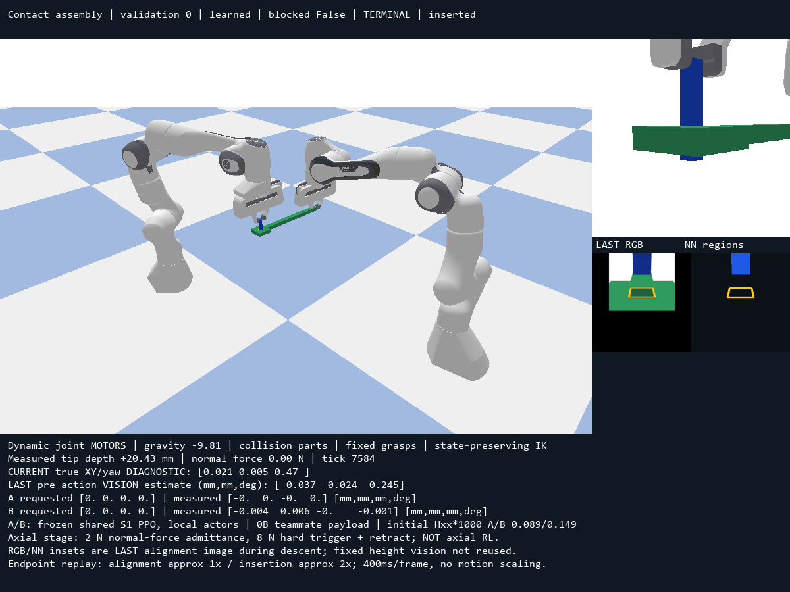

# Group 28 · Decentralized dual-arm fine alignment

**Foundations of AI: Multiagent Systems · IIT Gandhinagar**

How much teammate information is needed for two independently acting arms to divide a fine-alignment correction? The strongest no-message rule cost 1.1% more than the joint reference, and both aligned on all 1,000 paired fit-0 starts. The project also tests trained coordination with RGB observations and its transfer to dynamic, force-controlled insertion in PyBullet.

- **Recommended:** [Presentation-refined nine-page report](output/pdf/group28-dual-arm-mas-readable.pdf) · [Overleaf ZIP](output/group28-readable-overleaf.zip) · [Editable LaTeX](report-readable/main.tex)
- **LaTeX source submission:** [Complete source directory](report-readable/) (entry point: `main.tex`; includes all figures and dependencies). The current report includes author roll numbers and an AI-use declaration.
- [Original eight-page report, preserved for comparison](output/pdf/group28-dual-arm-mas.pdf) · [Original Overleaf ZIP](output/group28-overleaf.zip)
- [RGB-to-insertion replay](dual-arm-mas/runs/assembly-demo-v7/contact-assembly.gif) · [Replay telemetry](dual-arm-mas/runs/assembly-demo-v7/result.json)
- [Deterministic results](dual-arm-mas/runs/evaluation/analysis/summary.md) · [PPO alignment results](dual-arm-mas/runs/learned-study/analysis/summary.md) · [Contact results](dual-arm-mas/runs/contact-study-v2/analysis/summary.md)
- [Bundle verification record](verification/acceptance.json)

| Successful open-hole insertion | Blocked hole: jam and release |
| --- | --- |
|  |  |

These are PyBullet simulation frames, not hardware. In the replay, cooperative PPO decides the **planar alignment** corrections from neural RGB. A deterministic force-feedback controller then regulates **axial insertion**. The 1,216-trial contact evaluation is separate from the 25,280 learned alignment episodes and 23,456 deterministic alignment episodes.

## 1. Set up the reference environment

The refined report uses displayed equations, explanatory allocation/training/contact
diagrams, compact settings tables, and the team-confirmed contribution record.
The original scientific results and figures are unchanged. Build the alternative
with `python tools/build_readable_report.py` (requires matplotlib, pdflatex and
pdfinfo), or upload its self-contained ZIP to Overleaf. See
[the revision notes](report-readable/README.md).

Use **Windows x64 and Python 3.11**. From the top of this folder in PowerShell:

```powershell
py -3.11 -m venv .venv
$python = '.\.venv\Scripts\python.exe'
& $python -m pip install torch==2.11.0 --index-url https://download.pytorch.org/whl/cpu
& $python -m pip install -r requirements-reference.txt
```

The original runtime used Python 3.11.9 and PyTorch 2.11.0+cu128; CPU PyTorch suffices for checkpoint loading and replay. Training timings and bit-for-bit fresh simulator output are not portable guarantees. `tools/reproduce.py` explicitly imports `sfn` and `dual_arm_mas` from **this folder**, not an adjacent checkout or another editable install. PyBullet provides the Panda URDF and meshes via `pybullet_data`. The replay renderer expects Windows' Consolas font. Allow approximately 1.5 GB of free space for the bundle plus scratch verification and several minutes for full re-analysis.

## 2. Verify the reported numbers, without retraining

```powershell
& $python tools/reproduce.py hashes
& $python tools/reproduce.py verify --out check-all
```

Expected counters: **23,456** deterministic episodes, **25,280** learned alignment episodes, **1,216** corrected contact episodes in **14** groups, **12** PPO fits, and `statistics_match: true`. This derives results from raw episode records and frozen seeds, configurations, checkpoint and provenance data, then checks against the archived outputs; it does not just display the saved tables. It checks baseline coverage and paired resets, all selected actor fits, validation and logged parameter changes, and contact outcome metadata. Historical file modification times are not treated as scientific results after transport.

The checker verifies the SHA-256 manifest, restores the large deterministic JSONL and rebases original absolute keys only in a temporary copy. This preserves historical records exactly. The separate `restore` command optionally restores that file in-place for inspection; its raw SHA-256 is checked and the expanded file is ignored by Git. Do not commit the 117 MiB expanded file. The included gzip archive is sufficient. To regenerate the typeset figures/tables after verification:

```powershell
& $python tools/report_data.py --verified .work/check-all
```

This intentionally regenerates report assets. Work in a scratch copy if you also want to preserve the shipped manifest unchanged; `tools/seal.py` refreshes the manifest after deliberate report edits.

The revised report includes a vector execution-workflow diagram, matched GT/RGB PPO rows, and a stage-by-stage contact failure table. Its [failure-stage audit](verification/contact-failure-stages.json) records the group counts, episode IDs and failure reasons for all 1,024 main open-hole trials. The generator checks each raw JSONL against the audited digest before classifying it; blocked and stress trials are not pooled with these rows. See [editorial verification](verification/editorial-revision.json) for the current PDF and source checks. No new training was needed for these presentation changes.

## 3. Run new simulations or training

All names passed to `--out` must be new and relative to `.work/`. These commands do **not** append to the frozen evidence. The adapter replaces historical date gates only for new work and keeps the recorded simulation/training algorithms. A finite wall budget is checked between work units, so a final episode or update may extend slightly beyond the requested seconds. Increase the budget if coverage is incomplete.

```powershell
# Four saved-policy cases: fixed half, two learned opens, and blocked learned jam/release
& $python tools/reproduce.py demo --out replay-new --seconds 240

# Short fresh PPO and segmentation training checks, from the included data
& $python tools/reproduce.py train --regime s1 --fit 0 --steps 64 --batch-steps 64 --epochs 1 --out ppo-smoke --seconds 90
& $python tools/reproduce.py vision-train --epochs 1 --out vision-smoke --seconds 180

# Fresh evaluation of the archived model and a deterministic comparison
& $python tools/reproduce.py alignment-eval --regime s1 --fit 0 --sensing rgb --count 2 --out rgb-check --seconds 90
& $python tools/reproduce.py alignment-eval --condition drop25 --regime s2 --fit 0 --sensing rgb --count 2 --out dropout-check --seconds 90
& $python tools/reproduce.py contact-eval --group open-fit0-s1-rgb --count 2 --out contact-check --seconds 90
& $python tools/reproduce.py baseline-eval --scenario core --count 2 --out baseline-check --seconds 90
```

For a full PPO fit use `--steps 10000 --batch-steps 256 --epochs 5`, set `--fit 0`, `1` or `2` and `--regime s1`, `s2`, `s3` or `s4`, and allow an appropriate local work budget. Vision adaptation uses 16 epochs by default, reusing the bundled 192/24 train/validation images. The historical selected checkpoint is not necessarily the last checkpoint. To reproduce other impairment settings, select the named condition and allowed regime from `dual-arm-mas/configs/learned_study.json` or the corresponding baseline/contact config. Raw results, model checkpoints and telemetry from new work go under `.work/`. **Short smoke runs validate executability, not scientific performance.** Load only the package's verified checkpoints or models you trust; PyTorch training snapshots include state beyond tensor weights.

## 4. Locate the evidence

| Path | Contents |
| --- | --- |
| `dual-arm-mas/src/`, `scripts/`, `configs/`, `tests/` | Frozen algorithms, simulator, CLIs, experiment definitions and checks. Use the `tools/` wrapper for new launches. |
| `dual-arm-mas/runs/rl-s*-40*/` | All 12 PPO fits, including training JSONL, validation rows, candidate checkpoints, selected/latest/initial weights, optimizer and RNG state. |
| `dual-arm-mas/runs/vision-adaptation/` | Training/validation RGB and masks, manifests, learning records, checkpoints and the deployed segmenter. |
| `dual-arm-mas/runs/{train-311,train-312,train-313,validation,test}/` | Seeded joint starts and public models. Contact held-out starts are under `contact-momentum-fix/`. |
| `dual-arm-mas/runs/{evaluation,learned-study,contact-study-v2}/` | Raw production experiments, configurations via linked pins, summaries, snapshots and audit records. The large deterministic log is in `evidence/` until restored. |
| `dual-arm-mas/runs/contact-study/` | **Stopped diagnostic branch:** 553 episodes predating state-preserving IK. Do not mix with the corrected contact study. |
| `peg-in-hole-sfn/sfn/`, `peg-in-hole-sfn/models/` | Only the SFN Python foundation and pretrained initialization needed here. |

Smaller pilots and diagnostics are retained as historical work, not additional test-set outcomes. Archived audits may refer to paths on the original host; use `verify` for the portable audit. The eight-page report is the course submission; the historical proposal and technical report remain unchanged outside this bundle.

## Credits and scope

Original method: [Liang Xie et al., ICRA 2022 / arXiv:2204.07776](https://arxiv.org/abs/2204.07776), with [original SFN source](https://github.com/xieliang555/SFN). The [single-arm implementation](https://single-spider.github.io/SFN/) was Gaurav Srivastava's MTech thesis work under Prof. Harish P M. The course project adds the shared two-arm world, information-constrained policies, paired comparisons, adapted perception and contact transfer study. Only the course results above evidence the dual-arm system. They do not establish hardware behavior, frictional grasp robustness, global optimality, or an RL motion-cost advantage.

LaTeX style: Moulay A. Akhloufi's [Arxiv & PRIME AI template](https://www.overleaf.com/latex/templates/arxiv-and-prime-ai-style-template/qdnhqytdqzsc), based on George Kour's arXiv style. See [template attribution](report/TEMPLATE.md).
